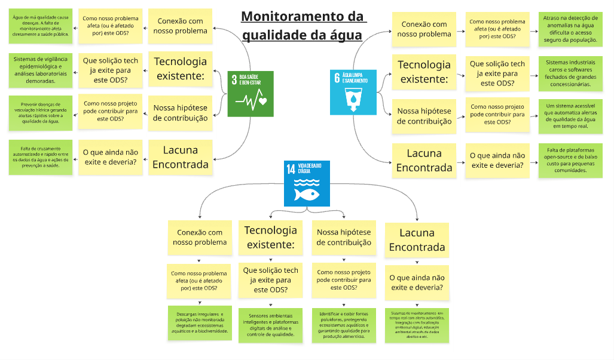

# Definição do tema e mapa ODS × tecnologia

## Tema e problema

**Tema:** monitoramento local da qualidade da água.

**Problema em uma frase:** a falta de monitoramento acessível e contínuo atrasa a identificação de alterações na qualidade da água e a resposta de quem depende dela.

O projeto concentra o MVP em acompanhar um ponto de água por vez, com leituras exibidas no celular e histórico local. O [quadro do grupo no Miro](https://miro.com/app/board/uXjVH2GjmwE=/?share_link_id=390171388875) serviu de base para o mapa abaixo. A [imagem anexada](assets/mapa-ods-tecnologia.png) preserva o registro visual da atividade anterior.

## Mapa ODS × tecnologia

| ODS | Relação com o problema | Tecnologia existente e lacuna do mapa | Contribuição delimitada do Aqua Monitor |
| --- | --- | --- | --- |
| 3 — Saúde e Bem-Estar | Água de má qualidade pode causar doenças; detectar mudanças tarde prejudica a saúde pública. | Vigilância epidemiológica e análises laboratoriais podem demorar. | Exibir leituras e emitir alertas locais para apoiar a decisão de investigar a água. |
| 6 — Água Potável e Saneamento | O atraso em detectar anomalias dificulta o acesso seguro à água. | Sistemas industriais caros e softwares fechados de grandes concessionárias; faltam plataformas abertas e de menor custo para pequenas comunidades. | Usar sensor conectado por Bluetooth e app Android para leitura, histórico e alertas sem internet. |
| 14 — Vida na Água | Descargas irregulares e poluição não monitorada degradam ecossistemas aquáticos. | Sensores ambientais inteligentes e plataformas digitais de análise e controle já existem; o mapa aponta a lacuna de monitoramento acessível e comunicação rápida. | Registrar tendências de parâmetros da água e permitir exportar dados para apoiar a investigação de eventos. |

### ODS 3 — Saúde e Bem-Estar

A contribuição é **prevenção e aviso antecipado**. Um alerta do aplicativo indica que um parâmetro passou do limite configurado; não diagnostica doença nem substitui ensaio de potabilidade.

### ODS 6 — Água Potável e Saneamento

A contribuição é **acesso a dados locais**. O aplicativo funciona sem internet e conserva leituras no celular. O custo total ainda depende do ESP32, das sondas, da calibração e da manutenção.

### ODS 14 — Vida na Água

A contribuição é **registro para observação ambiental**. As medidas podem indicar alterações que merecem investigação, mas quatro parâmetros de um ponto de coleta não identificam automaticamente uma fonte de poluição nem descrevem todo um ecossistema.

## Limite da solução

O MVP não mede microrganismos, contaminantes químicos específicos ou todas as condições necessárias para declarar água potável. O firmware em [`firmware/esp32_example.ino`](../firmware/esp32_example.ino) é um exemplo e exige calibração com sondas reais antes de qualquer uso prático. A frase de corte do MVP e o APK estão no [README](../README.md).
